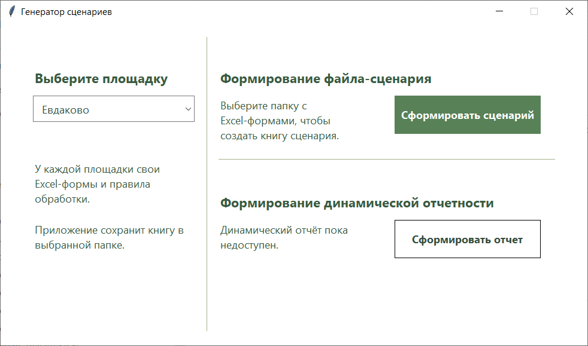
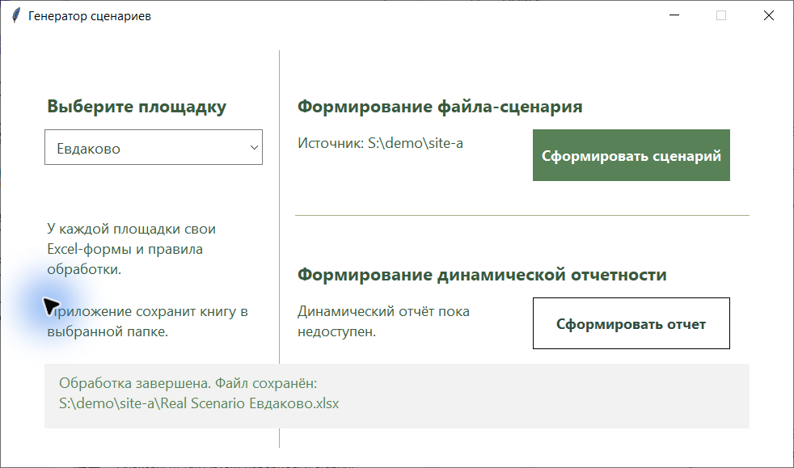
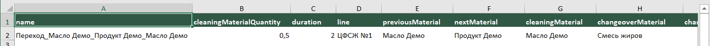

# Scenario Generator

**Два Python ETL-пайплайна и Windows-приложение для подготовки производственного сценария из Excel.** Проект автоматизирует чтение разнородных форм, проверку схем, нормализацию и экспорт связанных таблиц. Я разработал логику преобразований в Power Query M и Python, Desktop-интерфейс на Tkinter и Windows-сборку на PyInstaller.



## Что делает приложение


Для двух площадок предусмотрены отдельные пайплайны. Генератор нормализует даты и единицы измерения, связывает поступления со справочником материалов, преобразует месячный план в заказы и раскладывает матрицы переналадок в строки. Например, ячейка `2 / Масло Демо / 0,5` превращается в запись с длительностью `2`, материалом промывки `Масло Демо` и количеством `0,5`. Пустые ячейки пропускаются, а о некорректном значении приложение сообщает с указанием позиции.

| Материал | Что посмотреть |
| --- | --- |
| [Python ETL · Евдаково](scenario-generator.py) | Рецептуры, отгрузки, матрицы фасовки и экспорт книги на 49 листов |
| [Python ETL · ЭПИ](scenario-generator-epi.py) | Независимые правила для второй площадки и экспорт книги на 39 листов |
| [Desktop](desktop_app.py) | Выбор пайплайна, фоновая обработка, предупреждения и диагностика |
| [Power Query M](power-query/README.md) | Исторические запросы и их зависимости |
| [Проверки релиза](docs/VALIDATION.md) | Воспроизводимость демонстрации и сравнение результатов CLI и Windows-сборки |

## Запустить на Windows

1. Скачайте [ScenarioGenerator.exe](https://github.com/MrKostas/scenario-generator/releases/download/v0.1.3-portfolio/ScenarioGenerator.exe) и [демонстрационные данные](https://github.com/MrKostas/scenario-generator/releases/download/v0.1.3-portfolio/demo-inputs.zip). Распакуйте данные в папку, доступную для записи.
2. Запустите приложение. Для `site-a` выберите **Евдаково**, для `site-b` выберите **ЭПИ**. Нажмите **«Сформировать сценарий»** и укажите нужную папку.
3. Откройте сформированный Excel-файл. В `DemandRecord` есть заказ на 42 единицы массы, в `InitialStock` есть результат конвертации 2500 кг в 2,5 т. Пример результата показан ниже.





Для запуска готовой сборки нужны Windows x64 и права записи в папку входных файлов. Сборка без цифровой подписи. [Контрольные суммы](https://github.com/MrKostas/scenario-generator/releases/download/v0.1.3-portfolio/SHA256SUMS.txt)

### Данные и ограничения

Демонстрационные книги созданы с нуля и используют публичные псевдонимы форм. Desktop выбирает следующий месяц по дате запуска. Архив покрывает месяцы планирования с декабря 2026 по ноябрь 2029 года. Для другого месяца пересоздайте формы командой ниже. Книга сохраняется в выбранную папку, повторный успешный запуск заменяет файл с тем же именем. В ЭПИ некоторые выходные таблицы представлены только схемой. Интеграция с внешней системой планирования и заготовка динамического отчёта находятся за пределами демонстрации.

## Запуск из исходников и сборка

```powershell
py -3.12 -m venv .venv
.\.venv\Scripts\python.exe -m pip install -r requirements.txt
.\.venv\Scripts\python.exe demo\generate_inputs.py --output demo-inputs
.\.venv\Scripts\python.exe desktop_app.py
.\.venv\Scripts\python.exe -m unittest discover -s tests
.\build.ps1
```

`build.ps1` создаёт `dist/ScenarioGenerator.exe`. Вариант запуска из терминала для обеих площадок:

```powershell
.\.venv\Scripts\python.exe scenario-generator.py --source-dir demo-inputs/site-a --output-path demo-results/site-a.xlsx
.\.venv\Scripts\python.exe scenario-generator-epi.py --source-dir demo-inputs/site-b --output-path demo-results/site-b.xlsx
```

Автор проекта - [MrKostas](https://github.com/MrKostas). Приложение опубликовано как некоммерческий кейс портфолио. Уведомления о сторонних компонентах сборки приложены к релизу.

## English summary

Scenario Generator is a Windows desktop application for spreadsheet-driven production planning. Two site-specific pandas pipelines validate and reshape Excel inputs into structured scenario workbooks. The portfolio includes runnable synthetic fixtures, Python source, a PyInstaller build, and the historical Power Query M queries.
